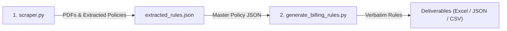

# Humana Payment Policy Intelligence Pipeline

A deterministic, verbatim payment policy intelligence and billing rule generation pipeline for **Humana Payment Policy** documents.

---

## 1. Pipeline Overview & Execution Workflow

The Humana pipeline processes payment policies across two main stages:



### Quick Run Commands (PowerShell)
```powershell
cd "c:\Users\dell\Documents\Payer Policy\Humana\payment policy"

# Step 1: Scrape and parse Humana payment policies
python scraper.py

# Step 2: Generate clean, verbatim billing rules and code linkages
python generate_billing_rules.py
```

---

## 2. Script Inventory & Responsibilities

| Script / File | Purpose | Key Inputs | Key Outputs |
| :--- | :--- | :--- | :--- |
| **`scraper.py`** | Scrapes policy PDFs and parses sections, paragraphs, bullet points, and code tables | Humana provider portal | `humana_policies/pdfs/`, `humana_policies/extracted_policies/`, `extracted_rules.json`, `policy_title_humana_payment.csv` |
| **`generate_billing_rules.py`** | Master deterministic rule generator & code mapper | `extracted_rules.json` | `billing_rules.xlsx`, `billing_rules.json`, `billing_rules.csv` |
| **`extracted_rules.json`** | Master extracted policy JSON (202 policies) | Output of scraper | Ingestion source for rule generation & central Knowledge Base |
| **`policy_title_humana_payment.csv`**| Registry of scraped policies and URLs | Portal metadata | Inventory tracking |

---

## 3. Core Operational Principles

1. **Verbatim Fidelity (Zero Hallucinated Words)**:
   Rules extract the untouched sentence text directly from policy sections, bullet points, definitions, and tables. No words are added.
2. **Deontic Keyword Triggers**:
   Sentences are selected using domain triggers:
   - *Denials & Non-Reimbursement*: `not eligible for reimbursement`, `will not be reimbursed`, `not covered`, `denied`, `bundled`.
   - *Modifiers*: `modifier 25`, `modifier 59`, `modifier 50`, `modifier 78`, `modifier JW`, `modifier JZ`.
   - *Frequency & Limits*: `once per`, `maximum units`, `frequency limit`.
   - *Place of Service & Supervision*: `place of service`, `supervision`, `observation`.
3. **Actionable Incorrect Billing Conditions**:
   Every rule provides a machine-evaluable condition explaining when a submitted claim should be flagged for non-compliance or audit review.

---

## 4. Master Deliverables

| Deliverable | Format | Records | Description |
| :--- | :--- | :--- | :--- |
| **`billing_rules.xlsx`** | Excel Workbook | 1,120 rules | Master multi-tab workbook with auto-filter and formatting: <br>• `Master Billing Rules`: 1,120 verbatim rules<br>• `Policy Summary`: Policy-level rule distributions<br>• `Code Index`: 2,868 code linkages across 523 unique codes<br>• `Rule Types Summary`: Breakdown by denial, modifier, limit, etc. |
| **`billing_rules.json`** | JSON Array | 1,120 rules | Structured machine-readable JSON array |
| **`billing_rules.csv`** | Flat CSV | 1,120 rules | Tabular export for SQL/data warehouse ingestion |

---

## 5. Output Schema Reference

The primary billing rules table contains the following columns:

| Column | Type | Example | Description |
| :--- | :--- | :--- | :--- |
| `Rule ID` | String | `HUM-BR-00001` | Unique sequential identifier |
| `Policy Number` | String | `CP2013083` | Official Humana policy number |
| `Policy Title` | String | `Modifiers JW and JZ` | Title of the payment policy |
| `Rule Type` | String | `Modifier Requirement` | `Denial`, `Reimbursement Criteria`, `Modifier Requirement`, `Bundling/Unbundling`, `Frequency Limit`, etc. |
| `Rule Statement` | String | *(Verbatim text)* | Exact, untouched sentence from the policy document |
| `Incorrect Billing Condition` | String | *(Evaluation condition)* | Specific criterion triggering claim denial or review |
| `Applicable CPT/HCPCS Codes` | String | `J0129, J0178` | Comma-delimited list of applicable codes |
| `Applicable Modifiers` | String | `JW, JZ` | Comma-delimited list of relevant modifiers |
| `Effective Date` | String | `2026-07-01` | Policy effective date |
| `Source Section` | String | `Payment Policy Guidelines` | Section origin (`Payment Policy Guidelines`, `Definitions`, `Coverage Limits`) |
| `Claim Requirements` | String | `Itemized charge, waste unit documentation` | Standard claim fields required for adjudication |

