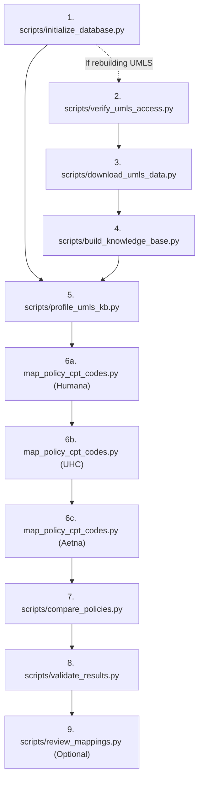

# KB Creation v1: End-to-End Pipeline & Operational Runbook

This document provides a comprehensive operational and architectural guide for **KB creation v1**. It covers the system architecture, prerequisites, script execution order, input/output specifications, and step-by-step instructions to replicate or run the pipeline in another directory.

---

## 1. System Overview & Architecture

**KB creation v1** is a deterministic, offline, high-performance CPT/HCPCS Knowledge Base and Policy Intelligence engine designed for healthcare payer coverage rules.

- **Deterministic & Non-Generative**: It does not rely on Large Language Models (LLMs) or generative AI, avoiding hallucinations and unrepeatable outputs. All code extractions, terminology links, and rule comparisons use deterministic NLP patterns, lexical/bag-of-words similarity, token-sort joins, and the **NLM UMLS (Unified Medical Language System) Metathesaurus**.
- **Embedded Analytical Storage (DuckDB)**: All pipeline layers—terminology references, raw ingested policies, parsed sections, extracted code mentions, consolidated mappings, rule logic, and cross-payer comparisons—are stored in an embedded DuckDB database file (`database/payer_policy_kb.duckdb`).
- **Payer-Agnostic Engine (Version 2)**: Core mapping and comparison engines are decoupled from payer-specific schemas. New payers are onboarded via configuration profiles (`config/payers/<payer>.json`) and JSON adapters (`sectioned_list`, `guidelines_document`, `declarative`) without altering engine code.

### Pipeline Architecture Flow

```
[ UMLS RRF Files (MRCONSO, MRSTY, MRREL) ]
                     │
                     ▼ (rrf_loader)
         [ Terminology Knowledge Base ] (DuckDB)
                     ▲
                     │ (Term matching / Concept joins)
[ Raw Payer JSONs ] ─┴─► [ Policy Corpus & Code Mentions ]
                                    │
                                    ▼ (mapping_consolidator)
                        [ Policy-CPT Mappings ] (Tiers A-E)
                                    │
                                    ▼ (rule_extractor)
                        [ Normalized Policy Rules ]
                                    │
                                    ▼ (policy_matcher & rule_comparator)
                        [ Cross-Payer Policy & Rule Gaps ]
```

---

## 2. Directory & Component Breakdown

```
KB creation v1/
├── config/
│   ├── settings.py              # Central Pydantic-style system settings & paths
│   ├── generic_phrases.json     # Static suppression list to prevent false-positive UMLS matches
│   └── payers/                  # Payer configuration profiles
│       ├── aetna.json           # Aetna schema mappings & section detection
│       ├── humana.json          # Humana schema mappings & section detection
│       └── unitedhealthcare.json# UHC guidelines document schema mappings
├── database/
│   ├── payer_policy_kb.duckdb   # The 196 MB embedded DuckDB analytical database
│   ├── schema.sql               # Full 4-layer database DDL definitions & index scripts
│   └── example_queries.sql      # Diagnostic and reporting SQL queries
├── src/                         # Modular application packages
│   ├── comparison/              # Policy matching (policy_matcher.py) & rule gap analysis (rule_comparator.py)
│   ├── enrichment/              # Concept hierarchy and cross-vocabulary enrichment
│   ├── ingest/                  # Adapters (sectioned_list, guidelines_document, declarative) & profile registry
│   ├── knowledge_base/          # Database manager, atomic transactions, 18 integrity validators
│   ├── mapping/                 # Pipeline coordinator, term matching, title/content inference, confidence tiers
│   ├── policy/                  # Raw JSON parsing, regex code extraction, rule pattern recognition
│   ├── reporting/               # CSV/JSON exporters and markdown audit dashboard generators
│   ├── umls/                    # NLM REST/Download client, RRF batch loader
│   └── utils/                   # Logging configuration and SHA-256 stable identifier hashing
├── scripts/                     # Operational CLI scripts (see Section 4)
├── data/
│   ├── input/                   # Source extraction JSON files from payers
│   ├── raw/                     # UMLS Metathesaurus archive and extracted RRF directory (data/raw/META/)
│   ├── exports/                 # Generated primary CSV, JSON, and Markdown reports
│   │   └── audit/               # Detailed audit logs, unresolved mentions, section coverage
│   └── review/                  # Human-in-the-loop review queues & gold-standard benchmarks
├── docs/                        # Architectural documentation (DESIGN.md, ADDING_A_PAYER.md, CHANGES_v2.md)
├── tests/                       # 59 automated pytest integration and unit tests
├── requirements.txt             # Python package dependencies
└── .env.example                 # Environment template for UMLS credentials
```

---

## 3. Prerequisites & Environment Setup

### 3.1 Python Environment & Dependencies
- **Python Version**: Recommended `3.11` or `3.12` (tested with 3.12 and DuckDB 1.5).
- In PowerShell, create and activate a virtual environment, then install dependencies:
  ```powershell
  python -m venv .venv
  .venv\Scripts\Activate.ps1
  pip install -r requirements.txt
  ```

### 3.2 Environment Variables (`.env`)
Create a `.env` file in the project root:
```powershell
Copy-Item .env.example .env
```
Edit `.env` to supply your NLM UMLS API key (required only if downloading/updating the Metathesaurus):
```ini
UMLS_API_KEY=paste-your-uts-api-key-here
```
> [!NOTE]
> If you reuse the existing `database/payer_policy_kb.duckdb` (196 MB), all UMLS terminology tables are **already loaded**. You do not need an active UMLS API key to run mapping or comparisons.

---

## 4. End-to-End Execution Sequence

Execute the scripts in the following order.



---

### Step 1: Initialize the Database Schema
- **Script:** `scripts/initialize_database.py`
- **When to Run:** Must be executed before any other script in a new environment. Idempotent: creates tables if they do not exist; upgrades safely without data loss if they do.
- **Command:**
  ```powershell
  python scripts\initialize_database.py
  ```
  *(To wipe the database file and re-initialize completely: `python scripts\initialize_database.py --recreate`)*
- **Primary Inputs:**
  - `database/schema.sql`
- **Outputs Generated:**
  - `database/payer_policy_kb.duckdb` (DuckDB database file)
  - Creates 20+ tables & views across 4 architectural layers:
    - *Metadata:* `schema_meta`, `processing_runs`, `kb_build_steps`
    - *Terminology:* `source_vocabularies`, `concepts`, `concept_semantic_types`, `terms`, `cpt_codes`, `concept_relationships`, `concept_definitions`, `code_enrichment`
    - *Policy Corpus:* `policies`, `policy_versions`, `policy_sections`, `code_mentions`, `policy_concepts`, `unmatched_terms`, `policy_rules`
    - *Results:* `policy_cpt_mappings`, `mapping_evidence`, `policy_pair_matches`, `rule_gap_findings`, `review_decisions`
  - Log: `logs/initialize_database_<timestamp>.log`

---

### Step 2: Verify UMLS Access *(Ground-up build only)*
- **Script:** `scripts/verify_umls_access.py`
- **When to Run:** Only when building UMLS Metathesaurus from NLM. Verifies that your API key is active and licensed for CPT, HCPCS, and SNOMED CT. *(Skip if using pre-built DuckDB).*
- **Command:**
  ```powershell
  python scripts\verify_umls_access.py
  ```
- **Primary Inputs:**
  - `.env` (`UMLS_API_KEY`)
- **Outputs Generated:**
  - Terminal status report displaying account permissions for `CPT`, `HCPCS`, `HCPT`, and `SNOMEDCT_US`.
  - Exit code: `0` (Success & CPT visible), `1` (Authenticated, CPT not licensed), `2` (Network/Auth error).
  - Log: `logs/verify_umls_access_<timestamp>.log`

---

### Step 3: Download UMLS Metathesaurus *(Ground-up build only)*
- **Script:** `scripts/download_umls_data.py`
- **When to Run:** Downloads the full Metathesaurus release from NLM and extracts necessary `.RRF` files into `data/raw/META/`. *(Skip if using pre-built DuckDB).*
- **Command:**
  ```powershell
  # Download directly via NLM API:
  python scripts\download_umls_data.py

  # Or unpack an existing ZIP downloaded via browser:
  python scripts\download_umls_data.py --zip C:\path\to\umls-2026AA-metathesaurus-full.zip
  ```
- **Primary Inputs:**
  - `.env` (`UMLS_API_KEY`) or local ZIP archive
- **Outputs Generated:**
  - `data/raw/umls-<release>-metathesaurus-full.zip` (raw archive)
  - `data/raw/META/MRCONSO.RRF` (Atoms, strings, codes)
  - `data/raw/META/MRSTY.RRF` (Semantic types)
  - `data/raw/META/MRREL.RRF` (Concept relationships)
  - `data/raw/META/MRSAB.RRF` (Source vocabulary metadata)
  - `data/raw/META/MRDEF.RRF` (Concept definitions)
  - `data/raw/META/MRRANK.RRF` (Term type precedence)
  - Log: `logs/download_umls_data_<timestamp>.log`

---

### Step 4: Build Knowledge Base *(Ground-up build only)*
- **Script:** `scripts/build_knowledge_base.py`
- **When to Run:** Loads and indexes the `.RRF` files into DuckDB in transactional, resumable batches. *(Skip if using pre-built DuckDB).*
- **Command:**
  ```powershell
  python scripts\build_knowledge_base.py
  ```
- **Primary Inputs:**
  - `data/raw/META/*.RRF`
  - `database/payer_policy_kb.duckdb`
- **Outputs Generated:**
  - DuckDB terminology tables populated: `source_vocabularies`, `concepts`, `terms`, `cpt_codes`, `concept_relationships`, `concept_definitions`, `code_enrichment`.
  - Build progress recorded in `kb_build_steps`.
  - Log: `logs/build_knowledge_base_<timestamp>.log`

---

### Step 5: Profile UMLS Knowledge Base
- **Script:** `scripts/profile_umls_kb.py`
- **When to Run:** Run to inspect the health and coverage of the loaded terminology tables.
- **Command:**
  ```powershell
  python scripts\profile_umls_kb.py
  ```
- **Primary Inputs:**
  - `database/payer_policy_kb.duckdb` (read-only)
- **Outputs Generated:**
  - `data/exports/umls_profile.json`: Machine-readable counts of terms, concepts, codes, and relationships.
  - `data/exports/umls_profile.md`: Formatted Markdown audit table detailing the active release, atom counts, and procedure lexicon size.
  - Log: `logs/profile_umls_kb_<timestamp>.log`

---

### Step 6: Map Policies to CPT/HCPCS Codes
- **Script:** `scripts/map_policy_cpt_codes.py`
- **When to Run:** Central mapping engine. Ingests raw payer JSON, extracts explicit codes, infers candidate codes via UMLS semantic joins, assigns confidence tiers (A–E), extracts policy rules, and writes all mapping/audit reports. Run once per payer dataset.
- **Commands:**
  ```powershell
  # Humana
  python scripts\map_policy_cpt_codes.py --input data\input\humana_extracted_contents.json --payer-profile humana

  # UnitedHealthcare
  python scripts\map_policy_cpt_codes.py --input data\input\unitedhealthcare_extracted_contents.json --payer-profile unitedhealthcare

  # Aetna
  python scripts\map_policy_cpt_codes.py --input data\input\aetna_extracted_contents.json --payer-profile aetna
  ```
  *(Optional flags: `--fuzzy-content` enables token-sort fuzzy matching on paragraph text; `--infer-attachments` runs terminology inference on attachment pages).*
- **Primary Inputs:**
  - Payer JSON files in `data/input/*.json`
  - Payer profiles in `config/payers/*.json`
  - `config/generic_phrases.json` (false-positive suppression)
  - `database/payer_policy_kb.duckdb`
- **Outputs Generated:**
  - **DuckDB Tables Populated:** `policies`, `policy_versions`, `policy_sections`, `code_mentions`, `policy_cpt_mappings`, `mapping_evidence`, `policy_rules`, `unmatched_terms`.
  - **Primary Exports in `data/exports/`:**
    - `policy_cpt_mappings.csv`: Primary output table (40k+ rows) linking policies to codes with confidence tiers A–E, provenance origin, scores, and flags.
    - `mapping_evidence.json`: Detailed JSON trace (258 MB) containing sentences, table coordinates, scores, and CUIs for every code match.
    - `code_mentions.csv`: Every individual code token extracted from source text (71 MB) with regex rule and validation status.
    - `ambiguous_mappings.csv`: Matches where multiple distinct codes competed for the same phrase.
    - `unmatched_terms.csv`: Clinical procedure phrases that did not map to any known code.
    - `cpt_reference.csv`: Unique codes referenced across all mapped policies.
    - `mapping_quality_report.md`: High-level quality metrics, confidence tier distributions, and run summary.
  - **Audit Exports in `data/exports/audit/`:**
    - `audit_summary.md`: Clean summary of extraction health, record counts, and provenance origins.
    - `source_documents.csv`: Character counts, section counts, and adapter used per policy.
    - `section_mapping_status.csv`: Status of every policy section (`explicit_codes`, `inferred_candidates`, `unresolved`, `not_applicable`).
    - `unresolved_mappings.csv`: Clinical sections where procedures were discussed but no code could be linked.
    - `mapping_quality_signals.csv`: Warning flags (e.g. `explicit_code_not_in_kb_release`).
    - `code_list_policies.csv`: Policies listing $\ge 150$ codes.
  - Log: `logs/map_policy_cpt_codes_<timestamp>.log`

---

### Step 7: Compare Policies & Analyze Rule Gaps
- **Script:** `scripts/compare_policies.py`
- **When to Run:** Run after at least two payers have been mapped into DuckDB. Finds equivalent policies across payers and detects rule discrepancies.
- **Commands:**
  ```powershell
  # Cross-payer comparison
  python scripts\compare_policies.py

  # Optional: also identify overlapping policies within the same payer
  python scripts\compare_policies.py --include-same-payer
  ```
- **Primary Inputs:**
  - Populated `policies`, `policy_cpt_mappings`, and `policy_rules` in `database/payer_policy_kb.duckdb`.
- **Outputs Generated:**
  - **DuckDB Tables Populated:** `policy_pair_matches`, `rule_gap_findings`.
  - **Exports in `data/exports/`:**
    - `matched_policy_pairs.csv`: Paired policies across payers, similarity scores, and match tiers (`strong`, `possible`, `weak`).
    - `policy_comparison_report.csv`: Matrix summarizing equivalent, differing, conflicting, or one-sided rules per policy pair across rule types (reimbursement, coverage, prior authorization, frequency limits).
    - `rule_gap_report.csv`: Clause-by-clause comparison log detailing specific discrepancies (e.g. *Codes only in Humana*, *Differs in indication scope*, *Conflicting reimbursement requirements*).
    - `unmatched_policies.csv`: Policies that have no corresponding counterpart in other payers.
    - `policy_change_impact.csv`: Historical version diff report (when multiple versions of a policy exist).
  - Log: `logs/compare_policies_<timestamp>.log`

---

### Step 8: Validate Results & Integrity Checks
- **Script:** `scripts/validate_results.py`
- **When to Run:** Validates database referential integrity and checks for orphaned records. If provided with a gold-standard CSV, calculates Precision, Recall, and F1 metrics.
- **Commands:**
  ```powershell
  # Automated 18 structural integrity checks
  python scripts\validate_results.py

  # With an expert-annotated gold benchmark:
  python scripts\validate_results.py --gold data\review\gold_mappings.csv
  ```
- **Primary Inputs:**
  - `database/payer_policy_kb.duckdb`
  - (Optional) `data/review/gold_mappings.csv`
- **Outputs Generated:**
  - `data/exports/validation_summary.json`: JSON summary of all 18 check results, or precision/recall statistics if evaluated against a gold file.
  - Terminal log reporting PASS/FAIL status for all integrity constraints.
  - Log: `logs/validate_results_<timestamp>.log`

---

### Step 9: Human-in-the-Loop Review *(Optional Workflow)*
- **Script:** `scripts/review_mappings.py`
- **When to Run:** When clinical experts need to review borderline or ambiguous inferred mappings and persist their decisions back into the database.
- **Step 9A: Export Review Queue**
  ```powershell
  python scripts\review_mappings.py export
  ```
  - *Generates:* `data/review/review_queue.csv` pre-populated with low-confidence or ambiguous mappings, evidence summaries, and empty columns for `decision`, `reviewer`, and `reason`.
- **Step 9B: Import Review Decisions**
  ```powershell
  # After reviewers populate decision ('approve' | 'reject' | 'add'):
  python scripts\review_mappings.py import data\review\review_queue.csv
  ```
  - *Updates:* Populates `review_decisions` in DuckDB, updates status in `policy_cpt_mappings` (`approved`, `rejected`, or `reviewer_added`), and logs historical provenance.

---

## 5. Output Files & Column Reference Guide

### 5.1 Primary Mapping Output: `data/exports/policy_cpt_mappings.csv`

| Column | Example Value | Description |
|---|---|---|
| `policy_uid` | `aetna:ae8f6bdd24d7` | Deterministic SHA-256 hash of payer name + source file identifier. |
| `payer` | `Aetna` | Name of the health plan / payer. |
| `policy_number` | `ABHIL-RP-0011` | Official policy code / ID assigned by the payer. |
| `policy_title` | `Allergy Testing and Immunotherapy` | Title of the reimbursement/coverage policy. |
| `code_system` | `CPT` | Code ontology: `CPT` (AMA) or `HCPCS_L2` (CMS Level II). |
| `code` | `95004` | 5-digit CPT code or alphanumeric HCPCS code. |
| `code_description` | `Percutaneous tests with allergenic extracts` | Official descriptor string from UMLS (subject to license flags). |
| `mapping_origin` | `explicit` | Source category: `explicit`, `supplementary`, `code_list_only`, `inferred`, `reviewer_added`. |
| `code_provenance` | `policy_table` | Specific document element: `policy_text`, `policy_table`, `policy_qa`, `attachment`. |
| `confidence_tier` | `A` | Qualitative confidence tier: **A** (Explicit validated), **B** (Explicit unreferenced or high-confidence inference $\ge 75$), **C** (Supplementary / code list $\ge 55$), **D** ($\ge 35$), **E** (< 35). |
| `score` | `100.0` | Numerical ranking score (0–100). |
| `best_method` | `explicit_code` | Algorithm that yielded the highest score (`explicit_code`, `descriptor_head`, `exact_synonym`, `cross_vocab_synonym`, `normalized_phrase`, `fuzzy`). |
| `needs_review` | `False` | Boolean indicating whether manual human verification is recommended. |
| `flags` | `explicit_code_not_in_kb_release` | Diagnostic flags (e.g. `ambiguous_candidate_set`, `possible_truncated_paragraphs`). |

---

### 5.2 Policy Comparison Summary: `data/exports/policy_comparison_report.csv`

| Column | Description |
|---|---|
| `pair_id` | Unique identifier for the matched policy pair. |
| `payer_a` / `payer_b` | The two payers being compared (e.g. `Humana` vs `UnitedHealthcare`). |
| `policy_title_a` / `policy_title_b` | The respective policy titles. |
| `match_tier` | Pairing strength: `strong` (high CPT code overlap), `possible`, `weak`. |
| `scope_alignment` | `aligned` (same clinical intent) or `differs` (different populations/indications). |
| `rule_type` | Category of rule analyzed: `reimbursement`, `coverage`, `exclusion`, `frequency_limit`, `prior_authorization`, `billing_instruction`. |
| `equivalent` | Count of rules that have identical intent and criteria across both payers. |
| `differing` | Count of rules addressing the same clinical scenario with differing requirements. |
| `conflicts` | Count of directly contradictory requirements (e.g., covered by A, strictly non-covered by B). |
| `only_in_a` / `only_in_b` | Rules specified by one payer with no counterpart in the other. |
| `not_assessable` | Rules that could not be evaluated due to incomplete text extraction or generic boilerplate. |

---

### 5.3 Detailed Discrepancy Log: `data/exports/rule_gap_report.csv`

| Column | Description |
|---|---|
| `pair_id` | Matched policy pair identifier. |
| `rule_type` | Category of rule (`applicable_codes`, `reimbursement`, `frequency_limit`, etc.). |
| `finding_type` | Specific gap type (e.g., `codes_only_in_a`, `differs_in_indication_scope`, `conflicting_requirements`, `not_assessable_incomplete_extraction`). |
| `rule_text_a` | Verbatim text from Policy A. |
| `rule_text_b` | Verbatim text from Policy B. |
| `detail` | JSON payload containing differing code sets, missing modifiers, or specific condition tags. |

---

## 6. How to Port and Run in Another Folder

Follow this checklist to clone, set up, and run this system in a new directory or server environment:

### Step 1: Copy Required Files
Copy the following directory tree to your target location:
```
Target_Directory/
├── config/              # All files and subfolders
├── database/            # schema.sql and example_queries.sql
│   └── payer_policy_kb.duckdb  # (RECOMMENDED: Copy this 196 MB file to skip UMLS rebuild)
├── scripts/             # All .py scripts
├── src/                 # All Python packages
├── data/
│   └── input/           # Place your new/existing payer JSON files here
├── docs/                # Operational and design documentation
├── tests/               # Test suite
├── requirements.txt
└── .env.example
```

> [!TIP]
> **Avoid Hours of UMLS Extraction**: If you copy the existing `database/payer_policy_kb.duckdb` file, you can immediately run Steps 1, 5, 6, 7, and 8. You do not need to download or parse UMLS RRF files.

### Step 2: Initialize Virtual Environment
In your new target folder:
```powershell
python -m venv .venv
.venv\Scripts\Activate.ps1
pip install -r requirements.txt
Copy-Item .env.example .env
```

### Step 3: Add a New Payer Profile (If Onboarding a New Payer)
If processing a new payer file (e.g. `data/input/cigna_extracted_contents.json`):
1. Inspect the JSON structure:
   ```powershell
   python -c "import json; d=json.load(open('data/input/cigna_extracted_contents.json')); print(type(d).__name__, list(d[0]) if isinstance(d, list) else list(d))"
   ```
2. Create a profile in `config/payers/cigna.json`:
   - If structured as a list of policies with section objects, set `"adapter": "sectioned_list"`.
   - If structured as a reimbursement guideline with Q&A and code tables, set `"adapter": "guidelines_document"`.
   - If using a bespoke schema, set `"adapter": "declarative"` and define key mappings in `"adapter_options"`. (See [docs/ADDING_A_PAYER.md](file:///c:/Payer%20Policy/KB%20creation%20v1/docs/ADDING_A_PAYER.md)).

### Step 4: Run the Execution Pipeline
Execute in PowerShell:
```powershell
# 1. Ensure DB schema exists
python scripts\initialize_database.py

# 2. Ingest & map policies for your payer(s)
python scripts\map_policy_cpt_codes.py --input data\input\cigna_extracted_contents.json --payer-profile cigna

# 3. Run cross-payer gap analysis against existing payers
python scripts\compare_policies.py

# 4. Run structural validation checks
python scripts\validate_results.py
```
Your fresh analytical reports and gap logs will be generated in `data/exports/` and `data/exports/audit/`.
