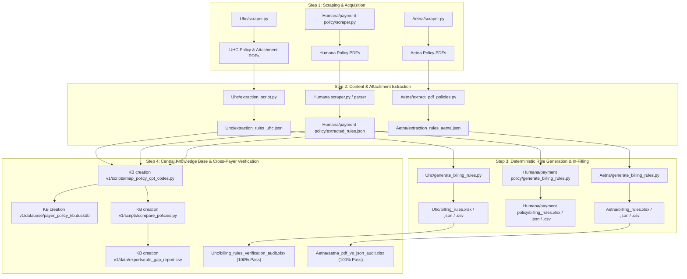

# Payer Policy Intelligence & Deterministic Billing Rule Generation Engine

An enterprise-grade, end-to-end payer policy intelligence platform that scrapes, extracts, and parses healthcare payment policies across major payers (**UnitedHealthcare**, **Humana**, **Aetna**) into clean, verbatim billing rules and actionable incorrect billing conditions for claims auditors, payment integrity teams, and concept engineers.

---

## 1. Clean System Architecture

Each payer pipeline follows a standardized, transparent 3-step architecture with zero redundant scripts:



---

## 2. Core Operational Principles

1. **Verbatim Fidelity (Zero Hallucinated Words)**:
   Policy rule statements pick out the exact, untouched content from the policy reimbursement guidelines, definitions, tables, and Q&A entries. No paraphrasing, no generative rewriting.
2. **Keyword-Driven Selection**:
   Rule statements are selected using domain-grounded deontic keywords (denials, reimbursement criteria, frequency limits, bundling/unbundling, modifiers, place of service, exceptions).
3. **Attachment Value In-Filling**:
   For parameter-driven policies (e.g., Time Span Codes, Add-on Codes, Once in a Lifetime Procedures, Age-Based Codes), the parameters, time periods, and code pairings are cleanly populated directly from policy attachment tables.
4. **Actionable Incorrect Billing Conditions**:
   Generates clean, unambiguous conditions required for claims editing engines and auditors to evaluate claims for non-compliance.
5. **No Clutter / Clean Codebase**:
   Only essential scripts supporting the pipeline are retained. All intermediate, one-off, and redundant scripts have been permanently pruned.

---

## 3. Directory Structure & Script Inventory

```text
c:\Users\dell\Documents\Payer Policy\
├── README.md                                          <-- Master Platform Documentation (You are here)
│
├── Uhc\                                               <-- UnitedHealthcare Pipeline
│   ├── README.md                                      <-- UHC Subsystem Documentation
│   ├── scraper.py                                     <-- Step 1: Scrapes UHC policies & attachments
│   ├── extraction_script.py                           <-- Step 2: Extracts PDFs into extraction_rules_uhc.json
│   ├── policy_lib.py                                  <-- Shared parsing, segmentation, & extraction library
│   ├── claim_requirements.py                          <-- Canonical claim columns assigner
│   ├── generate_billing_rules.py                      <-- Step 3: Master rule generator & attachment in-filler
│   ├── extraction_rules_uhc.json                      <-- Master extracted policy JSON (147 policies)
│   ├── policy_title_uhc.csv                           <-- Scraped document registry
│   ├── billing_rules.xlsx                             <-- Master UHC Billing Rules Workbook (4 sheets, 1,116 rules)
│   ├── billing_rules.json                             <-- Master UHC Billing Rules JSON (1,116 rules)
│   ├── billing_rules.csv                              <-- Master UHC Billing Rules CSV (1,116 rules)
│   ├── billing_rules_verification_audit.xlsx          <-- Forensic audit trail (100% verified consistent)
│   ├── uhc_pdf_vs_json_audit.xlsx                     <-- PDF vs. JSON completeness audit report
│   ├── commercial_plans\                              <-- Commercial policy PDFs
│   ├── medicare_advantage_plans\                      <-- Medicare Advantage policy PDFs
│   ├── extracted_contents_reimbursement\              <-- Per-policy JSON extractions
│   └── policy_attachments\                            <-- Policy attachment PDFs (TimeSpan, Add-on, etc.)
│
├── Humana\                                            <-- Humana Pipeline
│   └── payment policy\
│       ├── README.md                                  <-- Humana Subsystem Documentation
│       ├── scraper.py                                 <-- Scrapes and parses Humana payment policies
│       ├── generate_billing_rules.py                  <-- Master rule generator
│       ├── extracted_rules.json                       <-- Master extracted policy JSON (202 policies)
│       ├── policy_title_humana_payment.csv            <-- Scraped document registry
│       ├── billing_rules.xlsx                         <-- Master Humana Billing Rules Workbook (1,120 rules)
│       ├── billing_rules.json                         <-- Master Humana Billing Rules JSON (1,120 rules)
│       ├── billing_rules.csv                          <-- Master Humana Billing Rules CSV (1,120 rules)
│       └── humana_policies\                           <-- PDFs and per-policy extractions
│
├── Aetna\                                             <-- Aetna Pipeline
│   ├── README.md                                      <-- Aetna Subsystem Documentation
│   ├── scraper.py                                     <-- Scrapes Aetna payment policies
│   ├── extract_pdf_policies.py                        <-- Extracts Aetna PDFs (Sections A–E) into JSON
│   ├── policy_lib.py                                  <-- Parsing & segmentation library
│   ├── claim_requirements.py                          <-- Claim fields assigner
│   ├── generate_billing_rules.py                      <-- Master rule generator
│   ├── extraction_rules_aetna.json                    <-- Master extracted policy JSON (35 policies)
│   ├── billing_rules.xlsx                             <-- Master Aetna Billing Rules Workbook (212 rules)
│   ├── billing_rules.json                             <-- Master Aetna Billing Rules JSON (212 rules)
│   ├── billing_rules.csv                              <-- Master Aetna Billing Rules CSV (212 rules)
│   ├── aetna_pdf_vs_json_audit.xlsx                   <-- Completeness audit report (100% extraction pass)
│   ├── aetna_il_payment_policies\                     <-- Policy PDFs
│   └── extracted_contents\                            <-- Per-policy JSON extractions
│
└── KB creation v1\                                    <-- Central Knowledge Base & Ontology Mapping
    ├── README.md                                      <-- KB Subsystem Documentation
    ├── PIPELINE_RUNBOOK.md                            <-- Quick Execution Runbook
    ├── config\                                        <-- Configuration and payer profiles (aetna, humana, uhc)
    ├── database\payer_policy_kb.duckdb                <-- Central DuckDB Knowledge Base (196 MB)
    ├── scripts\                                       <-- KB CLI commands:
    │   ├── initialize_database.py                     <-- Initialize DuckDB schema
    │   ├── map_policy_cpt_codes.py                    <-- Semantic UMLS/CPT code mapper
    │   ├── compare_policies.py                        <-- Cross-payer policy gap analysis
    │   └── validate_results.py                        <-- Structural & referential integrity checks (18 checks)
    ├── src\                                           <-- Modular mapping, ingestion adapters, & comparison engine
    ├── data\                                          <-- Ingest inputs (`data/input/`) & primary exports (`data/exports/`)
    ├── docs\                                          <-- Architectural references (DESIGN.md, END_TO_END_GUIDE.md, ADDING_A_PAYER.md)
    └── tests\                                         <-- Regression test suite (60 passed, 3 skipped, 0 failures)
```

---

## 4. End-to-End Pipeline Execution

### UnitedHealthcare (UHC)
```powershell
cd "c:\Users\dell\Documents\Payer Policy\Uhc"

# Step 1: Scrape policy PDFs and attachments
python scraper.py

# Step 2: Extract PDF contents into extraction_rules_uhc.json
python extraction_script.py

# Step 3: Generate clean, verbatim billing rules with attachment parameter in-filling
python generate_billing_rules.py
```

### Aetna
```powershell
cd "c:\Users\dell\Documents\Payer Policy\Aetna"

# Step 1: Scrape policies
python scraper.py

# Step 2: Extract PDF contents (Sections A through E)
python extract_pdf_policies.py

# Step 3: Generate billing rules
python generate_billing_rules.py
```

### Humana
```powershell
cd "c:\Users\dell\Documents\Payer Policy\Humana\payment policy"

# Step 1: Scrape policies
python scraper.py

# Step 2: Generate billing rules
python generate_billing_rules.py
```

### Central Knowledge Base (KB creation v1)
```powershell
cd "c:\Users\dell\Documents\Payer Policy\KB creation v1"

# Step 1: Initialize DuckDB database schema
python scripts\initialize_database.py

# Step 2: Ingest & map policies to CPT/HCPCS
python scripts\map_policy_cpt_codes.py --input data\input\extraction_rules_uhc.json --payer-profile unitedhealthcare
python scripts\map_policy_cpt_codes.py --input data\input\extracted_rules_humana.json --payer-profile humana
python scripts\map_policy_cpt_codes.py --input data\input\extraction_rules_aetna.json --payer-profile aetna

# Step 3: Cross-payer policy comparison & gap detection
python scripts\compare_policies.py

# Step 4: Referential validation & regression tests
python scripts\validate_results.py
python -m pytest tests
```

---

## 5. Summary of Deliverables & Verifications

| Payer / Subsystem | Deliverable | Location | Records | Status / Audit Result |
| :--- | :--- | :--- | :--- | :--- |
| **UnitedHealthcare** | Master Rules Workbook (Excel) | [`Uhc/billing_rules.xlsx`](file:///c:/Users/dell/Documents/Payer%20Policy/Uhc/billing_rules.xlsx) | 1,116 rules | Complete with in-filled attachment values, code index, and executive summaries |
| **UnitedHealthcare** | Master Rules (JSON) | [`Uhc/billing_rules.json`](file:///c:/Users/dell/Documents/Payer%20Policy/Uhc/billing_rules.json) | 1,116 rules | Structured machine-readable array |
| **UnitedHealthcare** | Master Rules (CSV) | [`Uhc/billing_rules.csv`](file:///c:/Users/dell/Documents/Payer%20Policy/Uhc/billing_rules.csv) | 1,116 rules | Tabular database export format |
| **UnitedHealthcare** | Rule Verification Audit | [`Uhc/billing_rules_verification_audit.xlsx`](file:///c:/Users/dell/Documents/Payer%20Policy/Uhc/billing_rules_verification_audit.xlsx) | 1,116 rules | 20-column forensic audit trail: **100.0% Verified Consistent** |
| **UnitedHealthcare** | PDF vs. JSON Completeness Audit | [`Uhc/uhc_pdf_vs_json_audit.xlsx`](file:///c:/Users/dell/Documents/Payer%20Policy/Uhc/uhc_pdf_vs_json_audit.xlsx) | 147 policies | 100% substantive rules captured from disk PDFs |
| **Aetna** | Master Rules Workbook (Excel) | [`Aetna/billing_rules.xlsx`](file:///c:/Users/dell/Documents/Payer%20Policy/Aetna/billing_rules.xlsx) | 212 rules | 1,423 code linkages across 425 unique codes |
| **Aetna** | Master Rules (JSON) | [`Aetna/billing_rules.json`](file:///c:/Users/dell/Documents/Payer%20Policy/Aetna/billing_rules.json) | 212 rules | Structured machine-readable array |
| **Aetna** | Master Rules (CSV) | [`Aetna/billing_rules.csv`](file:///c:/Users/dell/Documents/Payer%20Policy/Aetna/billing_rules.csv) | 212 rules | Flat tabular export format |
| **Aetna** | PDF vs. JSON Completeness Audit | [`Aetna/aetna_pdf_vs_json_audit.xlsx`](file:///c:/Users/dell/Documents/Payer%20Policy/Aetna/aetna_pdf_vs_json_audit.xlsx) | 35 policies | **35 / 35 (100.0%) Complete Extraction** (Sections A, B, C, D, E) |
| **Humana** | Master Rules Workbook (Excel) | [`Humana/payment policy/billing_rules.xlsx`](file:///c:/Users/dell/Documents/Payer%20Policy/Humana/payment%20policy/billing_rules.xlsx) | 1,120 rules | 2,868 code linkages across 523 unique codes |
| **Humana** | Master Rules (JSON) | [`Humana/payment policy/billing_rules.json`](file:///c:/Users/dell/Documents/Payer%20Policy/Humana/payment%20policy/billing_rules.json) | 1,120 rules | Structured machine-readable array |
| **Humana** | Master Rules (CSV) | [`Humana/payment policy/billing_rules.csv`](file:///c:/Users/dell/Documents/Payer%20Policy/Humana/payment%20policy/billing_rules.csv) | 1,120 rules | Flat tabular export format |
| **Central Knowledge Base** | Embedded Analytical DB | [`KB creation v1/database/payer_policy_kb.duckdb`](file:///c:/Users/dell/Documents/Payer%20Policy/KB%20creation%20v1/database/payer_policy_kb.duckdb) | 196 MB | 4-layer schema, CPT/UMLS ontology, 18 integrity constraints PASS |
| **Central Knowledge Base** | Cross-Payer Policy Mappings | [`KB creation v1/data/exports/policy_cpt_mappings.csv`](file:///c:/Users/dell/Documents/Payer%20Policy/KB%20creation%20v1/data/exports/policy_cpt_mappings.csv) | 46,000+ rows | Confidence tiers A–E with full evidence traceability |
| **Central Knowledge Base** | Regression Test Suite | `KB creation v1/tests` | 63 tests | **60 passed, 3 skipped, 0 failures** |
