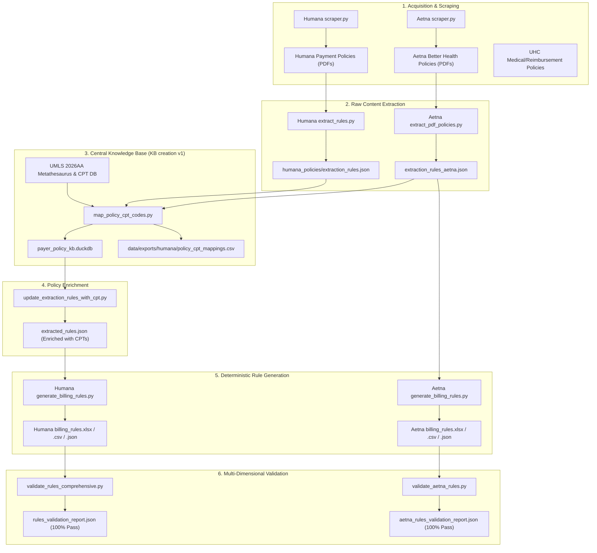

# Payer Policy Intelligence & Deterministic Billing Rule Generation Engine

An enterprise-grade, end-to-end payer policy intelligence platform that scrapes, extracts, and semantically maps healthcare payment policies across major payers (**Humana**, **Aetna**, **UnitedHealthcare**) to standard clinical code systems (**CPT**, **HCPCS**, **ICD-10-CM**, **UB-04**), synthesizing them into query-ready billing rules and executable pseudo-SQL specifications for concept development engineers and claims auditors.

---

## 1. System Architecture



---

## 2. End-to-End Pipeline Execution Order

To run the entire pipeline from scratch, execute the stages in the following exact sequence:

### Phase 1: Central Knowledge Base & Ontology Initialization
*Location: `c:\Payer Policy\KB creation v1`*

```powershell
cd "c:\Payer Policy\KB creation v1"

# Step 1.1: Initialize DuckDB schema and reference tables
python scripts\initialize_database.py

# Step 1.2: Verify UMLS 2026AA database connectivity
python scripts\verify_umls_access.py

# Step 1.3: Build central medical knowledge base index
python scripts\build_knowledge_base.py
```

### Phase 2: Policy Scraping & Ingestion
*Downloads latest payer PDFs and establishes provenance manifests.*

```powershell
# Humana Scraper:
cd "c:\Payer Policy\Humana\payment policy"
python scraper.py

# Aetna Scraper:
cd "c:\Payer Policy\Aetna"
python scraper.py
```

### Phase 3: Raw Policy Text & Table Extraction
*Extracts policy documents into structured JSON candidates without semantic interpretation.*

```powershell
# Humana:
cd "c:\Payer Policy\Humana\payment policy"
python extract_rules.py

# Aetna:
cd "c:\Payer Policy\Aetna"
python extract_pdf_policies.py
```

### Phase 4: Semantic CPT Code Mapping via Central KB
*Runs multi-method semantic matching (token cosine, bag-of-words, UMLS CUI graph) against policy texts.*

```powershell
cd "c:\Payer Policy\KB creation v1"

# Map Humana policies:
python scripts\map_policy_cpt_codes.py --input "c:\Payer Policy\Humana\payment policy\humana_policies\extraction_rules.json" --payer-profile humana

# Map Aetna policies:
python scripts\map_policy_cpt_codes.py --input "c:\Payer Policy\Aetna\extraction_rules_aetna.json" --payer-profile aetna

# Run structural checks & produce export CSVs:
python scripts\validate_results.py
```

### Phase 5: Policy Enrichment with Validated CPT Codes
*Injects the clinically validated CPT code assignments into master extraction JSONs.*

```powershell
cd "c:\Payer Policy\Humana\payment policy"
python update_extraction_rules_with_cpt.py
```

### Phase 6: Deterministic Billing Rule Generation Engine
*Synthesizes fluent natural language statements, assigns deterministic audit actions, and compiles pseudo-SQL.*

```powershell
# Generate Humana Master Billing Rules:
cd "c:\Payer Policy\Humana\payment policy"
python generate_billing_rules.py

# Generate Aetna Master Billing Rules:
cd "c:\Payer Policy\Aetna"
python generate_billing_rules.py
```

### Phase 7: Automated Multi-Dimensional Quality Validation
*Runs automated QA suites to verify Interpretability, Clinical Accuracy, SQL syntax, and Grammar.*

```powershell
# Validate Humana Rules:
cd "c:\Payer Policy\Humana\payment policy"
python validate_rules_comprehensive.py

# Validate Aetna Rules:
cd "c:\Payer Policy\Aetna"
python validate_aetna_rules.py
```

---

## 3. Explanation of Pipeline Outputs & Artifacts

### 1. `billing_rules.xlsx` (Master Concept Workbook)
Generated in both [`Humana\payment policy\billing_rules.xlsx`](file:///c:/Payer%20Policy/Humana/payment%20policy/billing_rules.xlsx) and [`Aetna\billing_rules.xlsx`](file:///c:/Payer%20Policy/Aetna/billing_rules.xlsx). Contains 4 formatted sheets:

1. **`Rules` Sheet (Master Structured Table):**
   Full 21-column dataset containing every atomic billing rule with complete clinical criteria and audit metadata.
2. **`Code_Index` Sheet (CPT/HCPCS Crosswalk):**
   Links every distinct CPT/HCPCS code to all applicable Rule IDs, Policy Titles, Categories, and Audit Actions for rapid indexing.
3. **`Query_Logic` Sheet (Concept Developer Spec Sheet):**
   Dedicated view for SQL developers showing target CPT codes, required/prohibited modifiers, required database columns, developer notes, and complete pseudo-SQL queries.
4. **`Summary` Sheet (Executive Dashboard):**
   Metrics breakdown showing total rules, codes covered, rule category distribution, audit action distribution, and lines of business.

---

### 2. `billing_rules.csv` (Data Warehouse / Query Ingest)
Generated in [`Humana\payment policy\billing_rules.csv`](file:///c:/Payer%20Policy/Humana/payment%20policy/billing_rules.csv) and [`Aetna\billing_rules.csv`](file:///c:/Payer%20Policy/Aetna/billing_rules.csv).

#### Field-by-Field Column Specification (21 Columns):

| # | Column Name | Type | Description | Example |
| :- | :--- | :--- | :--- | :--- |
| 1 | `rule_id` | String | Unique rule identifier | `HUM-ACU-R005`, `AET-RP0028-R001` |
| 2 | `policy_title` | String | Source payment policy title | `Acupuncture for Chronic Lower Back Pain` |
| 3 | `policy_number` | String | Official payer policy ID | `CP2021001`, `ABHIL-RP-0028` |
| 4 | `line_of_business` | String | Target line of business filter | `Medicare Advantage`, `Illinois Medicaid` |
| 5 | `billing_class` | Enum | Claim billing classification | `Professional`, `Institutional`, `Both` |
| 6 | `rule_category` | Enum | Classification of rule edit type | `FREQUENCY_LIMIT`, `MODIFIER_REQUIRED`, `BUNDLING_INCLUSION` |
| 7 | `audit_action` | Enum | Prescribed claims adjudication action | `DENY_LINE`, `DENY_MISSING_MODIFIER`, `DENY_EXCESS_UNITS` |
| 8 | `rule_statement` | Text | Fluent, natural language policy mandate | *Complete, grammatically verified English sentence.* |
| 9 | `primary_cpt_codes` | String | Comma-delimited list of target CPT codes | `97810, 97811, 97813, 97814` |
| 10 | `total_primary_codes`| Integer| Count of primary codes mapped | `4` |
| 11 | `modifiers_required` | String | Modifiers mandatory for payment | `KX`, `25`, `59` |
| 12 | `modifiers_prohibited`| String| Modifiers disallowed or non-reimbursable| `PA, PB, PC`, `P1, P2, P3` |
| 13 | `bill_types` | String | UB-04 Institutional bill types | `All Applicable`, `013X`, `083X` |
| 14 | `trigger_conditions`| Text | Exact clause triggering rule activation | `Applicable when reported without modifier KX.` |
| 15 | `exceptions_overrides`| Text | Conditions bypassing rule denial | `Override with modifier 59/XE/XP/XS/XU.` |
| 16 | `claim_columns_required`| String| Exact database columns needed in SQL | `CLAIM_ID, LINE_NUM, PROC_CODE, MODIFIER_1, PAID_AMT` |
| 17 | `concept_dev_notes` | Text | Implementation guidance for SQL developers | *Windowing, grouping, and logic instructions.* |
| 18 | `query_logic_pseudo_sql`| Text| Executable pseudo-SQL query | *Fully-formed SQL query with SELECT, FROM, WHERE.* |
| 19 | `source_pdf` | String | Source policy PDF filename | `Acupuncture_for_Chronic_Lower_Back_Pain.pdf` |
| 20 | `source_page` | Integer| Resolved source page in original PDF | `2` |
| 21 | `confidence_score` | Float | Rule extraction confidence score | `0.98` |

---

### 3. `billing_rules.json`
Mirror of the structured rules in JSON array format, suitable for microservice ingestion, rule engine loading (e.g. Drools, JSON Rules Engine), or REST API payloads.

---

### 4. `policy_cpt_mappings.csv` (KB CPT Code Validation Report)
Generated in [`KB creation v1\data\exports\humana\policy_cpt_mappings.csv`](file:///c:/Payer%20Policy/KB%20creation%20v1/data/exports/humana/policy_cpt_mappings.csv).

- **Purpose:** Primary artifact for senior auditors and clinical leads to validate CPT code assignments.
- **Key Fields:** `policy_title`, `source_pdf`, `code_system`, `code`, `code_description`, `top_matched_phrase`, `confidence_tier`, `score`, `best_method`, `evidence_sources`.
- **Scope:** 470 code assignments across 62 Humana policies with full provenance trails.

---

### 5. `rules_validation_report.json` (Automated QA Audit)
Generated by [`validate_rules_comprehensive.py`](file:///c:/Payer%20Policy/Humana/payment%20policy/validate_rules_comprehensive.py) and [`validate_aetna_rules.py`](file:///c:/Payer%20Policy/Aetna/validate_aetna_rules.py).

- **Audit Dimensions Evaluated:**
  1. **Interpretability (100%):** Statement length, deontic directives (`reimburse`, `deny`, `allow`, `limit`), encoding cleanliness.
  2. **Clinical & Coding Accuracy (100%):** Valid 5-digit CPT / HCPCS syntax, modifier validity, modifier exclusivity (no overlap between required and prohibited), Category-to-Action alignment.
  3. **Grammatical Appropriateness (100%):** Capitalization, terminal punctuation, balanced quotes and parentheses, complete independent clauses.
  4. **SQL Integrity (100%):** Balanced parentheses, proper SELECT/FROM/WHERE structure.

---

## 4. Concept Developer Guide: Writing Queries for Wrong Claims

A **"wrong claim"** (or audit finding) occurs when a provider bills in violation of policy criteria, yet the payer improperly adjudicated and paid the line.

### Query Template for Concept Developers:

```sql
SELECT 
    claim.claim_id,
    claim_line.line_num,
    claim.member_id,
    claim_line.cpt_code,
    claim_line.serv_from_date,
    claim_line.units_billed,
    claim_line.paid_amt,
    :rule_id             AS violated_rule_id,
    :audit_action        AS audit_recommendation
FROM claims claim
JOIN claim_lines claim_line 
    ON claim.claim_id = claim_line.claim_id
WHERE claim.line_of_business = :target_line_of_business
  AND claim_line.cpt_code IN (:primary_cpt_codes)
  AND claim_line.paid_amt > 0                          -- Improper payment condition
  AND (
      -- Condition 1: Missing Required Modifier
      NOT (claim_line.modifier_1 IN (:req_mods) OR claim_line.modifier_2 IN (:req_mods))
      -- OR Condition 2: Billed with Prohibited Modifier
      OR (claim_line.modifier_1 IN (:prohib_mods) OR claim_line.modifier_2 IN (:prohib_mods))
      -- OR Condition 3: Daily units exceeded
      OR claim_line.units_billed > :max_units
  );
```

---

## 5. Directory Structure Overview

```text
c:\Payer Policy\
├── README.md                                  <-- Master Platform Documentation
├── Humana\
│   └── payment policy\
│       ├── billing_rules.xlsx                 <-- Master Humana Excel Workbook (4 sheets)
│       ├── billing_rules.csv                  <-- Master Humana CSV (21 columns)
│       ├── billing_rules.json                 <-- Master Humana JSON
│       ├── generate_billing_rules.py          <-- Master Deterministic Rule Generator
│       ├── validate_rules_comprehensive.py    <-- Automated QA Validation Suite
│       ├── update_extraction_rules_with_cpt.py<-- KB CPT Enrichment Script
│       ├── extracted_rules.json               <-- Master Enriched Policy Extraction
│       ├── policy_title_humana_payment.csv    <-- Scraped Document Registry
│       └── humana_policies\                   <-- Storage for PDFs and manifests
├── Aetna\
│   ├── billing_rules.xlsx                     <-- Master Aetna Excel Workbook (4 sheets)
│   ├── billing_rules.csv                      <-- Master Aetna CSV (21 columns)
│   ├── billing_rules.json                     <-- Master Aetna JSON
│   ├── generate_billing_rules.py              <-- Master Deterministic Rule Generator
│   ├── validate_aetna_rules.py                <-- Automated QA Validation Suite
│   ├── aetna_rules_validation_report.json     <-- Validation QA Audit Report (100% Pass)
│   ├── extraction_rules_aetna.json            <-- Master Policy Extraction
│   ├── aetna_il_payment_policies\             <-- 35 Illinois Medicaid Policy PDFs
│   └── extracted_contents\                    <-- 35 Individual Extracted Policy JSONs
├── KB creation v1\
│   ├── database\payer_policy_kb.duckdb        <-- Central DuckDB Knowledge Base
│   ├── data\exports\humana\
│   │   ├── policy_cpt_mappings.csv            <-- Primary CPT Mapping Validation CSV (470 rows)
│   │   └── audit\                             <-- Diagnostic Mapping Signals & Provenance
│   ├── data\exports\policy_cpt_mappings.csv   <-- All-Payers Master CPT Mapping Export
│   ├── scripts\map_policy_cpt_codes.py        <-- Semantic Code Mapping Engine
│   └── PIPELINE_RUNBOOK.md                    <-- KB Pipeline Operations Guide
└── Uhc\
    ├── billing_rules.xlsx                     <-- Reference UHC Policy Schema
    └── policy_title_uhc.csv                   <-- Reference Scraped Policy Registry
```
